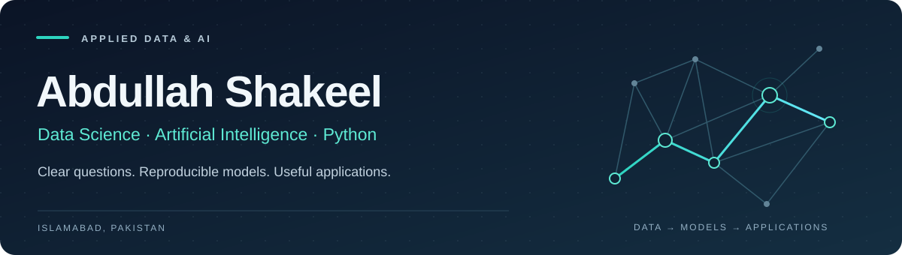

  

From raw data to models you can inspect and applications you can use.

  
  
  
  

[Selected projects](#selected-projects) &nbsp; / &nbsp; [Technical toolkit](#technical-toolkit) &nbsp; / &nbsp; [Background](#background) &nbsp; / &nbsp; [LinkedIn](https://www.linkedin.com/in/abdullah-shakeel-26aabb265/)

---

## Data science, with the evidence attached

I work with **Python, SQL and machine learning** to turn analytical questions into reproducible experiments and usable applications. My background includes operational reporting and billing-data analysis; my current portfolio focuses on NLP, model evaluation and Python interfaces.

For each project, I aim to make three things easy to inspect: **the decision, the result and the limitation.**

## Selected projects

### Sentiment classification under domain shift

Can a model trained on product and restaurant reviews transfer to movie reviews? I evaluate a TF-IDF/logistic-regression baseline on an attributed UCI dataset, with source separation, normalized-text deduplication and train-only preprocessing.

**Held-out IMDb:** 995 sentences · **0.7022 macro F1** · 70.95% accuracy versus 49.95% for a majority baseline. The full error file is included. This binary benchmark is separate from the authored three-class web example.

[Code](https://github.com/Abdulllah999/sentiment-baseline-lab) · [Evaluation protocol & findings](https://github.com/Abdulllah999/sentiment-baseline-lab/blob/main/docs/benchmark-findings.md) · [Reproducibility tests](https://github.com/Abdulllah999/sentiment-baseline-lab/blob/main/test_benchmark.py)

### Does sentiment improve a next-close forecast?

An expanding-window experiment compares Ridge with and without sentiment against persistence. On 71 synthetic test origins, **persistence has the lowest MAE: 0.7356**, versus 0.9177 for Ridge with sentiment. The result demonstrates why baseline comparison and time-aware validation matter.

[Code & measured comparison](https://github.com/Abdulllah999/market-forecast-lab) · [Every held-out prediction](https://github.com/Abdulllah999/market-forecast-lab/blob/main/artifacts/predictions.csv)

### Retention scenarios & SQL cohort analysis

A Streamlit dashboard paired with a SQLite report using a CTE, conditional aggregation and a window denominator. Tests reconcile cohort counts, spend sums and thresholds to the synthetic source. The model is compared with both a mean baseline and the exact generating formula.

[Dashboard & results](https://github.com/Abdulllah999/AI-Powered-Retention-Command-Center-Churn-Simulator) · [SQL query](https://github.com/Abdulllah999/AI-Powered-Retention-Command-Center-Churn-Simulator/blob/main/analytics/cohorts.sql) · [Reconciliation tests](https://github.com/Abdulllah999/AI-Powered-Retention-Command-Center-Churn-Simulator/blob/main/test_report.py)

**Additional Python work:** [Resume skill evidence](https://github.com/Abdulllah999/interview-evidence-lab), a deterministic Flask workflow for human review; and [synthetic model serving](https://github.com/Abdulllah999/health-patterns-demo), a validated educational API with unvalidated Flutter companion source.

## Technical toolkit

| Demonstrated in this portfolio | Evidence |
| :--- | :--- |
| **Python, Pandas, NumPy, Scikit-learn** | Text pipelines, feature engineering, baseline evaluation and public-data benchmarking |
| **SQL & analytical reporting** | SQLite cohort queries, window functions and reconciliation checks |
| **Flask, REST APIs, Streamlit, Plotly** | Validated interfaces, model-serving endpoints and interactive dashboards |
| **Git, pytest, GitHub Actions** | Versioned source, functional tests and automated reproduction |

Additional background: TensorFlow, NLTK, React, Flutter, MySQL, MongoDB, Excel, Power BI, Tableau and Docker. The repositories distinguish implemented features from unvalidated scaffolding.

## Background

**Virtual Assistant / Data and Billing Analyst · Ezcure MBS** 
October 2023 – May 2025 
Medical billing data, Excel dashboards, reporting and claim tracking.

**BS Information Technology · Bahria University, Islamabad** 
2021–2025 · Focus: Data Science and Artificial Intelligence · CGPA: **3.43 / 4.00**

## Career focus

Seeking **Data Science, Machine Learning and AI** opportunities where I can contribute Python development, analytical reasoning and reproducible evaluation.

The lab projects are current portfolio implementations inspired by earlier project ideas. Data provenance, methodology and scope are documented in each repository; no deployment or real-world business outcome is claimed.

[Connect on LinkedIn](https://www.linkedin.com/in/abdullah-shakeel-26aabb265/) · [Explore all repositories](https://github.com/Abdulllah999?tab=repositories)
